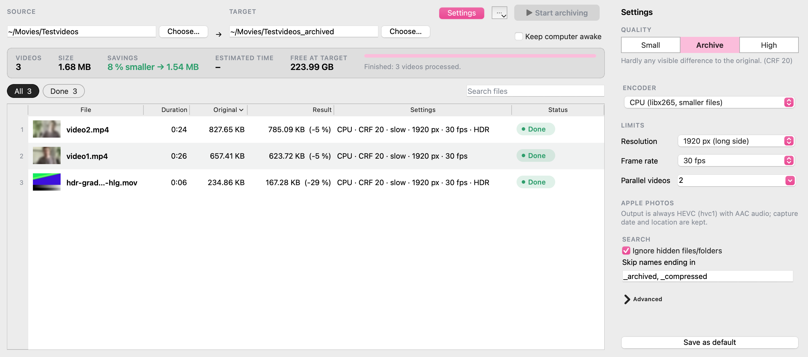

<p align="center">
  
</p>

# Video Helper Tools

[](https://github.com/faheinrich/video-helper-tools/actions/workflows/tests.yml)

Two desktop apps for working with videos, built from one repository:

| App | What it does | Folder |
|---|---|---|
| **Archive Helper** | compress videos for the archive (metadata kept), back up folders with rsync | [archive-helper](archive-helper) |
| **Analysis Helper** | synchronise recordings by audio, transcribe speech with Whisper to ELAN | [analysis-helper](analysis-helper) |



They are separate apps because their dependencies differ a lot: the archive app needs only Qt, FFmpeg and ExifTool,
the analysis app also ships PyTorch, OpenCV and friends. Both use the shared package in [core](core)
(window shell, translations, styles, app data paths).

```
core/              video-helper-core: shared by both apps
archive-helper/    Archive Helper (package archive_helper)
analysis-helper/   Analysis Helper (package analysis_helper)
```

## Development

The repository is a [uv](https://docs.astral.sh/uv/) workspace with one lock file:

```bash
uv sync --all-packages              # one environment with everything, including the dev tools
uv run pytest core/tests archive-helper/tests analysis-helper/tests    # run each folder separately in CI
```

Building an app (`build.sh`) uses `uv sync --inexact`, so it does not remove the other packages from this environment.
FFmpeg and ExifTool are needed for most tests (they are skipped when missing).

## Releases

A tag builds one app for macOS, Linux and Windows and publishes it as a GitHub release:

```bash
git tag archive-v<version> && git push origin archive-v<version>     # e.g. archive-v0.0.5
git tag analysis-v<version> && git push origin analysis-v<version>   # e.g. analysis-v0.0.2
```

The version in the tag must match the app's `pyproject.toml` (and `__version__`); the workflow checks that.
What changed in each version: [CHANGELOG.md](CHANGELOG.md).

## Who?
This project was created by and is maintained by me, Fabian Heinrich.

## License

This project is licensed under [CC BY-NC-SA 4.0](https://creativecommons.org/licenses/by-nc-sa/4.0/).
