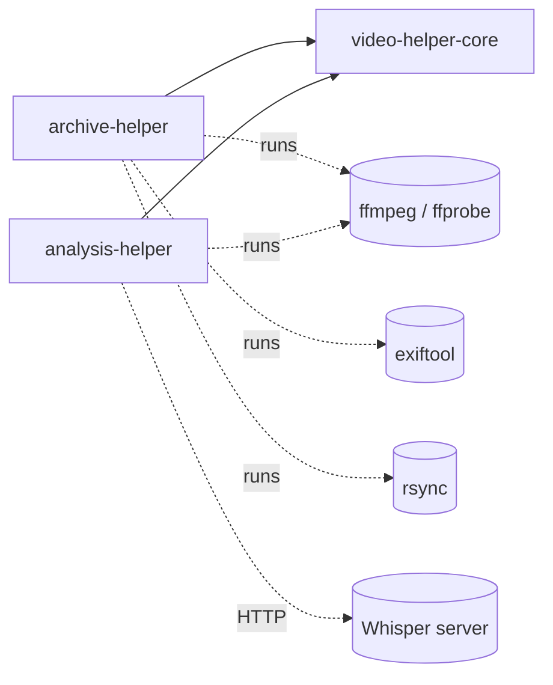

# Architecture

How the two apps are built: packages, modules, threads, external programs, data on disk, tests, CI and
releases. What the apps do is described in [features.md](features.md); the states and transitions are in
[state-machines.md](state-machines.md).

## Repository

A [uv](https://docs.astral.sh/uv/) workspace with three packages and one lock file (`uv.lock`):

```
core/               video-helper-core   shared window shell, translations, styles, paths, small helpers
archive-helper/     archive-helper      Archive Helper: compressor, backup page
analysis-helper/    analysis-helper     Analysis Helper: sync tool, transcriber
docs/               this documentation and the README's pictures
.github/            workflows (tests, release) and their scripts
CHANGELOG.md        changes per app and version
```

Why two apps:
- The archive app needs only PySide6 (Qt), FFmpeg and ExifTool.
- The analysis app also ships PyTorch, librosa, OpenCV, Silero VAD, FastAPI and transformers: several hundred MB
  more.
- Both depend on `video-helper-core` and nothing else of each other.



## Core (`core/video_helper_core`)

| Module | What it does |
|---|---|
| `shell.py` | The app window. Details below the table. |
| `i18n.py` | `tr(text, **values)`: English source strings in the code, one German table each app fills with `register_german`. A language change rebuilds the tool pages. |
| `style.py` | One shared Qt style sheet (chips, summary values, run button). It uses only palette roles that work in macOS dark mode. |
| `paths.py` | Per-app folders for settings and caches (see [Data on disk](#data-on-disk)); `VIDEO_HELPER_TOOLS_HOME` redirects them (tests). |
| `updates.py` | `UpdateChecker`: one request to the GitHub releases API in a daemon thread, filtered by the app's tag prefix; it never raises. |
| `media.py` | `MediaPlayer`: a `QMediaPlayer` whose play/pause/stop/setPosition release Python's GIL (a deadlock with Qt's audio thread otherwise). |
| `trash.py` | `move_to_trash`: the system trash via Qt; raises instead of deleting. |
| `keep_awake.py` | Keeps the computer awake during a run (macOS `caffeinate`, Windows `SetThreadExecutionState`, Linux `systemd-inhibit`). |
| `notify.py` | When a long job ends and the window is not in front: Dock bounce / taskbar flash and a system notification. |
| `dialogs.py` | Confirmation with a delayed button for destructive actions. |
| `testing.py` | Shared pytest fixtures. Details below the table. |

What `shell.py` holds:
- `AppSpec`: name, version, tools, release tag prefix.
- `SuiteWindow`: a title bar with a back button, a landing page that lists the tools, and the tool pages, which
  are built when first opened and then kept.
- The About dialog and the language switch.
- A close that asks while a tool `is_busy()` and then calls each tool's `shutdown()`.

What `testing.py` holds:
- an app home in `tmp_path`;
- the trash replaced by a folder;
- no update check;
- muted audio;
- `spin` and `wait_for` for Qt event loops.

A tool page is a plain `QWidget` that may offer two methods, `is_busy()` and `shutdown()`. The shell needs nothing
else from it.

## Archive Helper (`archive-helper/archive_helper`)

```
app.py                 AppSpec with the two tools; main()
translations.py        German texts
compressor/
  gui.py               ArchiverGUI: the page (folders, drawer, table, run control, file actions)
  model.py             VideoRow, VideoTableModel, VideoFilterProxy, delegates, status texts and sort keys
  workers.py           ArchiveWorker and the background workers; carry_metadata, add_missing_metadata
  boxes.py             MP4/MOV box reading and writing: maker boxes, track transplant, track and movie keys
  utils.py             ffprobe/exiftool helpers, metadata comparison, capture dates, sidecars, settings tag
  metadata_view.py     the metadata viewer (original and result side by side)
  lab.py               the compression lab (variants of a part)
  widgets.py           compare viewer, zoomable video views, drop field and drop overlay
  options.py           the drawer's choices (encoders, presets, resolutions, frame rates)
  exiftool_vht.config  defines the XMP namespace of the settings tag
rsync_gui/gui.py       RsyncSyncGUI: the backup page
```

### Model and view

- **Rows**: `VideoTableModel` holds a list of `VideoRow` dataclasses, one per video, keyed by the original's
  path.
- **Updates**: workers report by path, and `model.update(path, **fields)` changes the row and repaints it.
- **Filtering and sorting**: `VideoFilterProxy` filters by status (a set or a function) and text, and sorts with
  `VideoTableModel.sort_key`. The same key orders the processing queue, so the table order is the work order.
- **Display only**: the delegates paint the preview, the file name with its folder, and the status label with a
  progress bar.

### Threads

Qt objects live in the GUI thread. Long work runs elsewhere and reports through Qt signals, which Qt queues into
the GUI thread.

| Worker | Kind | Does |
|---|---|---|
| `UnifiedScanWorker` | QThread | walks the folders, predicts the result names, finds existing results |
| `ArchiveWorker` | QThread | the run: up to N ffmpeg processes, progress from their output, finalizing (metadata) |
| `ThumbnailLoader` | own `QThreadPool` (3) | preview pictures; can be held (viewer playing), cancelled (new folder), shut down (closing) |
| `DurationProbeWorker` | QThread + 6 probe threads | durations (cached) |
| `ResultSettingsWorker` | QThread | settings tag of existing results; reads the videos without one; stoppable |
| `BlockCheckWorker` | QThread with a queue | compares flat areas of result and original |
| `LabWorker`, `FrameWorker` | QThread | the lab's encodes and frames |
| metadata viewer | Python thread | exiftool for both files |
| `UpdateChecker` | Python daemon thread | the release check |

Rules that keep this from crashing or hanging (each one learned from a bug):
- A running `QThread` must not be destroyed: whoever owns one stops it and `wait()`s before letting go. A
  thread's own `finished`-like signal is sent from inside `run()`, so handlers wait for the thread before
  releasing it.
- Every worker the page waits for (new scan, closing) can be stopped quickly; closing never waits for previews
  or for reading hundreds of files.
- Signals of short-lived `QRunnable`s go to methods of long-lived objects, never to lambdas (the signal object
  may be freed before the queued call arrives).
- Player calls go through `MediaPlayer` (GIL released).

### The run (`ArchiveWorker`)

- **The loop**: `run()` starts encodes until the parallel limit is reached. It reads their stderr without
  blocking (POSIX; on Windows the reads block per process), parses `time=` and `speed=`, and finalizes each
  finished process (see [state machine E](state-machines.md#e-one-encode-in-the-worker)).
- **The queue**: `set_queue` replaces the waiting part from the GUI; started videos are never queued again.
- **Pause and stop**: pause suspends the process groups (SIGSTOP / `NtSuspendProcess`); stop kills them and
  deletes the partial files.
- **Priority**: ffmpeg runs in its own process group with low priority (`nice 10` / below-normal class) unless
  switched off.

### Metadata (`workers.carry_metadata`, `boxes.py`, `utils.py`)

ffmpeg writes a new container: it keeps the picture and sound, but drops most of the metadata. The original's
`moov` cannot be copied as a whole, because its sample tables describe the original's frames. So the metadata is
carried over in layers, each one adding what the earlier ones cannot:

1. **Tracks** (`transplant_tracks`): data tracks (timecode, Apple mebx, Cinematic depth, GoPro GPS, subtitles) are
   moved with their samples into a new `mdat`. Their ids, references, durations and chunk offsets are rewritten.
2. **Track metadata** (`copy_track_metadata`): the picture and sound tracks' own `meta`/`udta`, byte for byte.
3. **Maker boxes** (`copy_maker_boxes`): `udta` children, `uuid` boxes and top-level `meta` (Sony XML), byte for
   byte.
4. **exiftool** `-tagsFromFile`: XMP as a packet, then all writable tags, the capture date when the original has
   none inside, and the settings tag.
5. **Movie keys** (`copy_movie_keys`): the `moov/meta` keys exiftool does not know, added after it.
6. **Comparison** (`missing_metadata`): exiftool `-a -G1 -u` of both files, plus the side tracks via ffprobe.
   Some differences are ignored:
   - what compressing changes by its nature (container, codec, sizes, offsets);
   - empty fields;
   - padding;
   - track renumbering.

   What remains is stored in the settings tag as `metadata_missing`.

Old formats (AVI, AVCHD) cannot hold their structures in MP4. Their values go to standard fields
(`LEGACY_TAG_COPIES`), and all of it is also kept as text in the settings tag.

**The settings tag**:
- It is the XMP field `XMP-vht:CompressionSettings`, holding JSON (namespace in `exiftool_vht.config`).
- It records: version, app version, date, encoder and settings, source (name, size, format), where an added
  capture date came from, and `metadata_missing`.
- Results without it show what `encoding_from_file` reads from the video, marked "≈". For x265 that includes the
  CRF and the preset, matched from the options x265 writes into the stream.

`add_missing_metadata` gives a result of an earlier version the metadata it lacks, without compressing again:
- It works on a hidden copy that replaces the result in one step.
- The result's file times are kept.

### File safety

- A result is written to `NAME.partial.mp4` and renamed with `os.replace` only when complete.
- Anything replaced or removed (an earlier result, a replaced original, file actions) goes through
  `move_to_trash`. When the trash refuses, nothing is changed.
- Replacing an original with a larger result does nothing (`KEPT ORIGINAL`).

## Analysis Helper (`analysis-helper/analysis_helper`)

```
app.py                 AppSpec; main() also runs the Whisper server when started with its flag (frozen app)
sync/
  gui.py               VideoSyncGUI: two players, waveforms, shift, save
  video_synch.py       audio extraction (ffmpeg), FFT cross-correlation, trimming
  benchmark.py         robustness benchmark of the shift finder
  info.py              the info dialog
transcriber/
  gui.py               WhisperGui: single file and batch, server control, waveform
  transcribe_video_to_elan.py   VAD (Silero), requests to the server, ELAN file (pympi)
  run_minimal_whisper_server.py FastAPI server with a transformers Whisper pipeline
  protocol.py          request/response models, default address
```

- **The transcriber**:
  - `TranscriptionThread` (QThread) runs `transcribe_video` with a progress callback and a stop event.
  - The local server is a child process: `python -m …run_minimal_whisper_server`, or in the frozen app the app
    itself with a flag.
  - Its output is forwarded by `ServerLogThread`.
  - The heavy imports (torch, transformers) are only loaded in the server and on first use, so the app starts
    quickly.
- **The sync tool** works on the GUI thread (loading and the shift take seconds); temporary WAV and waveform
  files go to a temporary folder.

## External programs

| Program | Used for | Found |
|---|---|---|
| ffmpeg, ffprobe | encoding, probing, previews, frames, audio extraction, trimming | on `PATH`; the macOS app adds `/opt/homebrew/bin` and `/usr/local/bin` |
| exiftool | reading and writing metadata | on `PATH` |
| rsync | the backup page | on `PATH` (not on Windows by default: the page reports it) |

The players use Qt Multimedia's FFmpeg backend with software decoding (hardware decoding failed at the end of
some camera files).

## Data on disk

Per app (`Archive Helper`, `Analysis Helper`), via `core/paths.py`:

| | macOS | Windows | Linux |
|---|---|---|---|
| settings (`settings.json`) | `~/Library/Application Support/<App>/` | `%APPDATA%\<App>\` | `$XDG_CONFIG_HOME/<app-slug>/` |
| caches (`thumbnails/`, `durations.json`, `encode_speed.json`) | `~/Library/Caches/<App>/` | `%LOCALAPPDATA%\<App>\` | `$XDG_CACHE_HOME/<app-slug>/` |

- `settings.json` holds the language (`global`) and each tool's saved defaults.
- The previews are pruned by age.
- The transcriber keeps its own settings in `~/.whisper_gui_settings.json`.

## Tests

- **pytest per package**: `core/tests`, `archive-helper/tests`, `analysis-helper/tests`.
- **What they use**:
  - The tests make their own videos with ffmpeg (`testsrc2`, noise) and use the clips in
    `archive-helper/example_resources`.
  - Qt runs offscreen.
  - FFmpeg and ExifTool are needed for most of them and are skipped when missing.
- **Fakes**: the trash, the network, the Whisper server, the transcription and the archive worker
  (`fake_worker`) are replaced where a test is about the GUI's logic.
- **Coverage**: [state-machines.md](state-machines.md) maps every transition to its tests;
  `test_state_machines.py` holds the ones no other test covered.
- **Hangs**: `pytest-timeout` (300 s) ends a hanging test. A hang that holds the GIL is ended by `faulthandler`
  after 330 s with the stack of every thread, shown as an annotation on GitHub.

## CI and releases

- **`tests.yml`** (every push and pull request):
  - Runs each package on Ubuntu 24.04, macOS and Windows.
  - Installs Qt's libraries and exiftool on Linux without waiting on apt mirrors (`.github/scripts/linux_deps.sh`),
    and exiftool via choco on Windows and brew on macOS.
  - Uploads coverage to Codecov from Linux and turns failures into annotations
    (`.github/scripts/annotate_failures.py`).
- **`release.yml`** (tag `archive-v<version>` or `analysis-v<version>`):
  - Checks that the tag matches the app's `pyproject.toml`.
  - Builds the app with PyInstaller (`<app>/build.sh`) on macOS (Apple Silicon), Linux and Windows.
  - Packages it (`.zip` / `.tar.gz`) and publishes a GitHub release with all three.
  - The builds are unsigned.
- **CodeQL** (GitHub's default setup, no workflow file): scans the Python code and the workflows.
