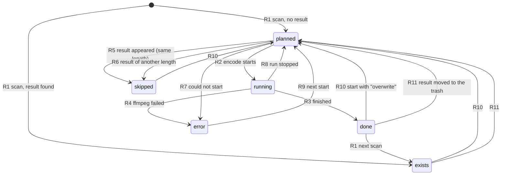
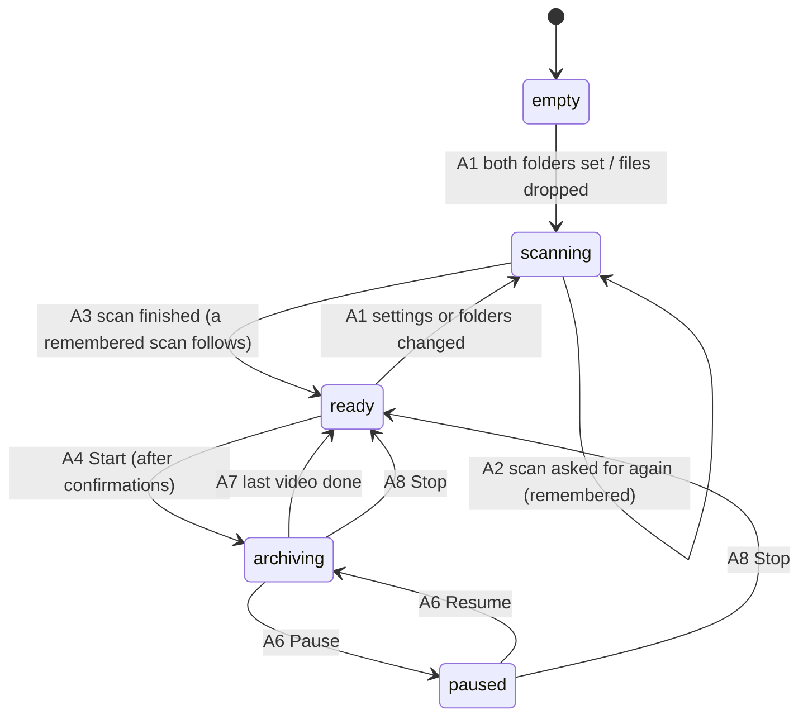
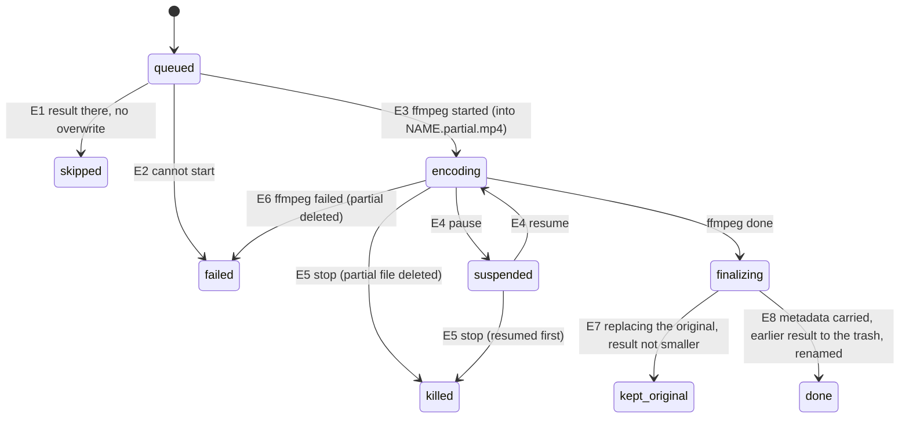
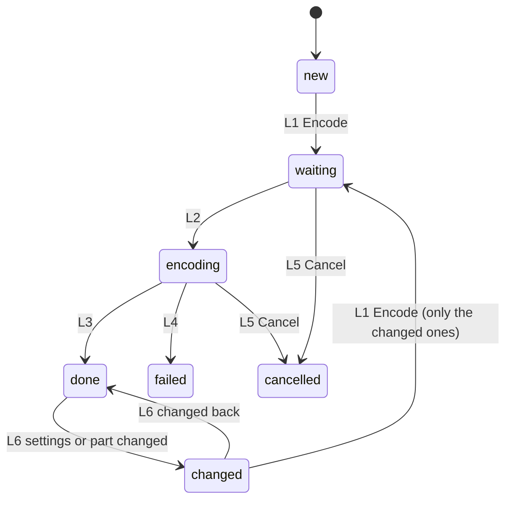
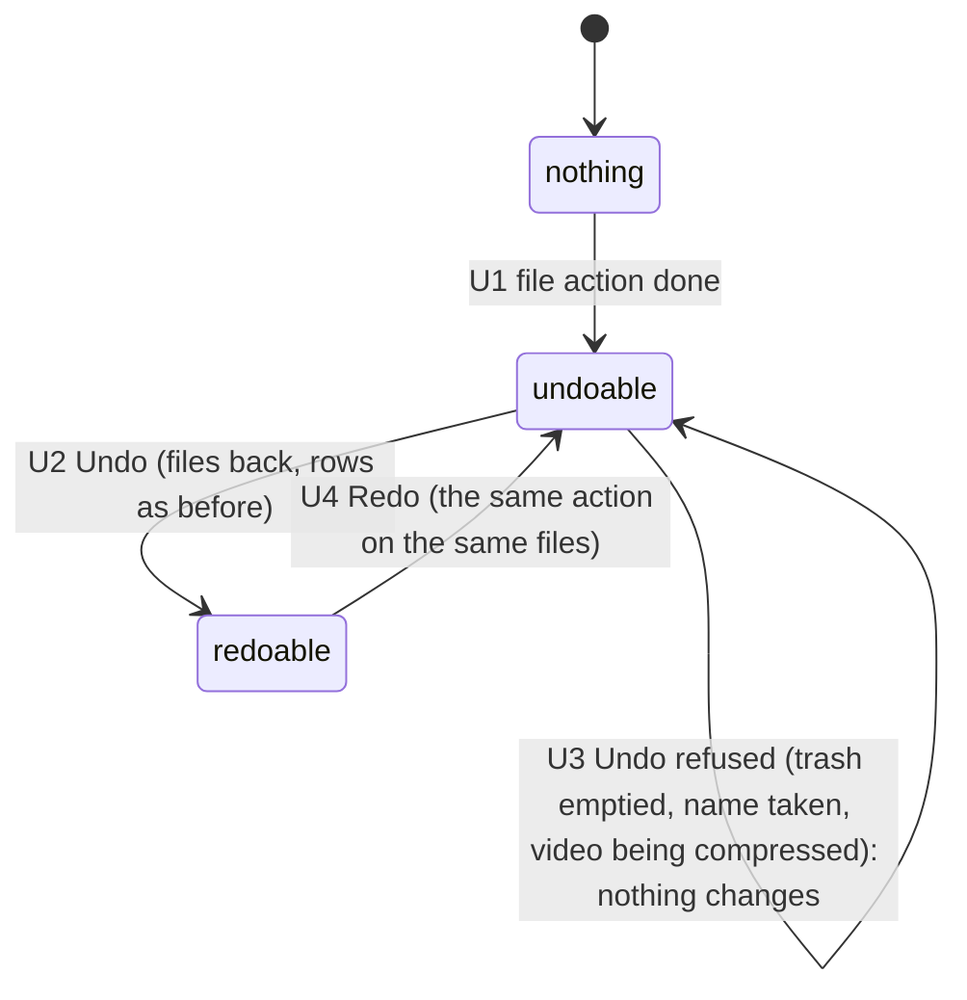
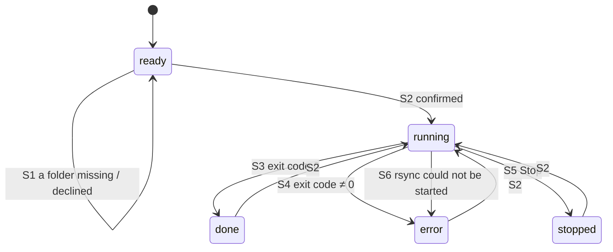
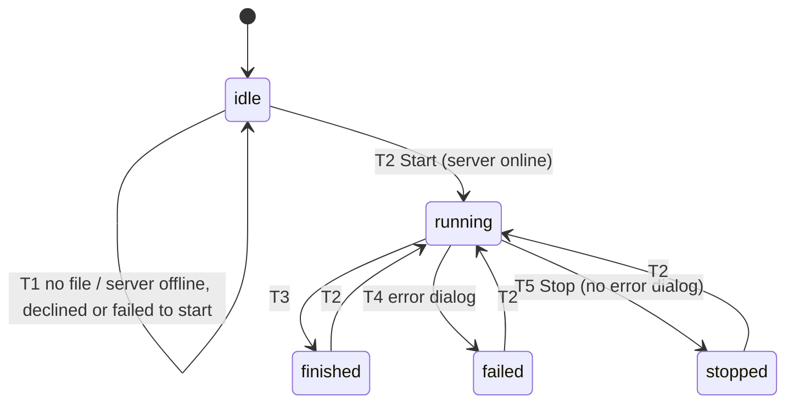

# State machines

The apps have no explicit state machine classes. Their states live in fields (a row's `status`, whether a worker
thread runs, a `paused` flag, a `QProcess` state) and their transitions in signal handlers. This document lists
them, with every transition and the test that covers it. A transition without a test is a gap.

Every transition below has a test.

Conventions:
- Each machine has a letter. Its transitions are numbered (R1, R2, …), and tests that cover only one transition
  name it in their name or docstring.
- File paths are relative to the package folder: `compressor/gui.py` means
  `archive-helper/archive_helper/compressor/gui.py`.
- Tests are named as `file::test`; `test_state_machines.py` collects transitions that no other test covered.

Overview:

| | Machine | Where |
|---|---|---|
| R | Status of a video row | Archive Helper, `compressor/gui.py`, `compressor/model.py` |
| A | The compressor page (scanning, archiving, paused) | `compressor/gui.py` |
| E | One encode in the worker | `compressor/workers.py` (`ArchiveWorker`) |
| B | Background readers (previews, durations, settings, block check) | `compressor/workers.py` |
| L | Compression lab | `compressor/lab.py` |
| C | Compare viewer | `compressor/widgets.py` (`CompareVideoDialog`) |
| M | Metadata viewer | `compressor/metadata_view.py` |
| U | Undo and redo of file actions | `compressor/row_actions.py`, `compressor/file_actions.py` |
| S | Backup page (rsync) | `rsync_gui/gui.py` |
| W | App window and update check | core, `shell.py`, `updates.py` |
| T | Transcriber, its batch and the Whisper server | Analysis Helper, `transcriber/gui.py` |
| Y | Sync tool | Analysis Helper, `sync/gui.py` |

---

## R: Status of a video row

`VideoRow.status`: `planned`, `running`, `done` (finished in this session), `error`, `skipped`, `exists` (a
result was there at the scan). On top of the status, a row has independent flags:
- `moved_up`: "Process next".
- `conflict`: the target is the source itself.
- `duplicate`: two sources share a target name.
- `note`: the reason of an error or skip.
- `settings`, `metadata_missing`, `block_check`: what is known about the result.

| # | Transition | Trigger | Tests |
|---|---|---|---|
| R1 | → `planned` / `exists` | scan finished (`on_unified_scan_finished`) | test_workers::test_scan_predicts_target_names_and_detects_existing_results, test_compressor::test_archive_run_end_to_end |
| R2 | `planned` → `running` | worker: `status_update_path(…, "running")` | test_state_machines::test_row_status_follows_the_worker[R2] |
| R3 | `running` → `done` | worker: `"finished"` with sizes and settings | …[R3], test_compressor::test_archive_run_end_to_end |
| R4 | `running` → `error` | ffmpeg exit code ≠ 0, or post-processing failed | …[R4], test_workers::test_run_marks_broken_files_as_error_and_continues |
| R5 | `planned` → `skipped` | target exists with the same length (only without "overwrite") | …[R5], test_workers::test_run_reports_skipped_videos_with_savings |
| R6 | `planned` → `skipped` | target exists with another length; it is left alone | …[R6], test_state_machines::test_e_a_result_of_another_length_is_skipped_and_kept |
| R7 | `planned` → `error` | the process could not be started | …[R7], test_workers::test_run_marks_a_video_that_cannot_be_started_as_error_with_the_reason |
| R8 | `running` → `planned` | the run ended while it was running (`on_finished_all`) | test_state_machines::test_r8_a_stopped_run_puts_its_running_videos_back_to_planned |
| R9 | `error` → `planned` | Start: errors are queued again | test_state_machines::test_r9_…, test_compressor::test_failed_videos_are_retried_on_the_next_start |
| R10 | `done`/`exists`/`skipped` → `planned` | Start with "overwrite existing results" (after a question) | test_state_machines::test_r9_…, test_r10_saying_no_to_overwrite_starts_nothing, test_compressor::test_overwrite_option_reprocesses_existing_results |
| R11 | result gone → `planned` | file actions (result to the trash; original replaced or swapped) | test_compressor::test_original_and_result_go_to_the_trash, test_replace_original_with_result, test_swap_original_and_result, test_nothing_is_deleted_when_the_trash_refuses |

The flags:
- `moved_up`: test_compressor::test_processing_order_follows_table_sort_and_moved_up_videos.
- `conflict`: test_compressor::test_same_source_and_target_file_is_flagged_not_skipped_and_not_shown_as_archived.
- `duplicate`: test_compressor::test_collisions_inside_one_flattened_folder_are_still_reported_as_duplicates.
- File actions are refused for a running row: test_compressor::test_file_actions_are_locked_only_for_the_video_being_compressed.

Derived from the row (not states of their own):
- "With problems" (`finished_problems`): metadata missing, visible blocks, larger than the original.
- The status filters and the order when sorting by status:
  test_model::test_sorting_by_status_puts_finished_videos_with_problems_together and
  test_compressor::test_finished_videos_split_into_this_session_already_archived_and_with_problems.

---

## A: The compressor page

States: **empty** (folders not set), **scanning**, **ready**, **archiving**, **paused**. A scan asked for while
scanning is remembered (`rescan_pending`).

| # | Transition | Notes | Tests |
|---|---|---|---|
| A1 | → scanning | automatically after a short delay once source and target are set | test_compressor::test_scan_starts_automatically_once_both_folders_are_set, test_drop.py |
| A2 | scanning → scanning | `start_unified_scan` while scanning sets `rescan_pending` | test_state_machines::test_a_scan_asked_for_while_scanning_runs_once_the_first_ends |
| A3 | scanning → ready | rows rebuilt; previews, durations and settings are read in the background (B) | same; test_compressor::test_start_button_follows_the_scan_and_says_why_it_is_disabled |
| A4 | ready → archiving | asks first when an original would be replaced (delayed button) or "overwrite" is on; refused while scanning or with an empty queue | test_compressor::test_starting_with_source_equals_target_needs_the_delayed_confirmation, test_no_confirmation_when_nothing_replaces_an_original, test_state_machines::test_r10_saying_no_to_overwrite_starts_nothing, test_compressor::test_start_button_follows_the_scan_and_says_why_it_is_disabled |
| A5 | archiving: queue changes | sorting, "Process next" and durations found reorder the waiting videos; started ones are never queued again | test_compressor::test_resorting_during_a_run_changes_the_remaining_order, test_reordering_never_requeues_a_started_video, test_durations_found_during_a_run_put_the_waiting_videos_in_order |
| A6 | archiving ⇄ paused | the ffmpeg processes are suspended; paused time does not count for the estimates; the computer may sleep | test_compressor::test_pause_freezes_the_run_and_lets_the_computer_sleep, test_paused_time_does_not_count_for_the_time_estimate |
| A7 | archiving → ready | the worker ends by itself: notification | test_compressor::test_a_finished_run_notifies_with_the_result |
| A8 | archiving/paused → ready | Stop: no notification; running rows back to planned (R8) | test_compressor::test_stopping_by_hand_sends_no_notification_and_releases_the_computer, test_state_machines::test_stopping_a_paused_run_ends_it |
| A9 | archiving: scan asked for | ignored (the rows are in use) | test_state_machines::test_a_scan_is_not_started_while_archiving |
| A10 | ready: Pause/Stop | do nothing | test_state_machines::test_pause_and_stop_do_nothing_when_no_run_is_going |

Keep awake follows the run and the checkbox: test_compressor::test_keep_awake_follows_the_checkbox_next_to_start.
Closing the window while archiving: W3.

---

## E: One encode in the worker

`ArchiveWorker.run` takes videos from its queue until it is empty or stopped, up to the chosen number at a time.

Finalizing (E8) runs, in this order:
1. The original's data tracks are transplanted.
2. The track metadata and the camera makers' boxes are copied.
3. exiftool copies all tags it can write.
4. The movie keys exiftool does not know are added.
5. Original and result are compared: what is missing is stored as `metadata_missing`.
6. File times are set.
7. An earlier result goes to the trash.
8. The result gets its final name in one step, and sidecar files are copied.

When the result is larger than the original, the original may also be copied next to it.

| # | Transition | Tests |
|---|---|---|
| E1 | → skipped (same length / another length) | test_workers::test_run_reports_skipped_videos_with_savings, test_state_machines::test_e_a_result_of_another_length_is_skipped_and_kept |
| E2 | → failed (start) | test_workers::test_run_marks_a_video_that_cannot_be_started_as_error_with_the_reason |
| E3 | → encoding | test_workers::test_run_compresses_a_queue_and_reports_progress |
| E4 | encoding ⇄ suspended | test_compressor::test_worker_pauses_and_resumes_its_processes |
| E5 | → killed | test_workers::test_stop_kills_running_encodes_and_removes_partial_files, test_compressor::test_worker_pauses_and_resumes_its_processes (stop while paused), test_state_machines::test_e_a_queue_change_after_stop_starts_nothing |
| E6 | → failed (ffmpeg) | test_workers::test_run_marks_broken_files_as_error_and_continues, test_state_machines::test_e_a_failed_encode_leaves_no_partial_file_and_an_earlier_result_alone |
| E7 | → kept original | test_state_machines::test_e_replacing_the_original_keeps_it_when_the_result_is_not_smaller |
| E8 | → done | test_compressor::test_archive_run_end_to_end, test_state_machines::test_e_with_overwrite_the_earlier_result_goes_to_the_trash, test_compressor::test_larger_output_keeps_photos_compatible_original, test_larger_output_does_not_copy_incompatible_original, test_larger_output_next_to_the_original_makes_no_second_copy, test_boxes.py and test_video_output.py (metadata) |

---

## B: Background readers

All of them start after a scan (A3) and must stop at once for a new scan or when the app closes.

| Reader | States | Tests |
|---|---|---|
| Previews (`ThumbnailLoader`) | idle → loading (3 at a time) ⇄ held while the viewer plays → cancelled (new folder) / shut down (closing) | test_workers::test_a_new_folder_drops_the_thumbnails_of_the_old_one, test_no_new_thumbnails_start_while_the_viewer_plays, test_closing_does_not_wait_for_the_thumbnails_of_a_large_folder, test_a_cancelled_thumbnail_stops_ffmpeg_and_leaves_no_file, test_compressor::test_every_thumbnail_arrives, test_no_new_thumbnails_are_made_while_the_viewer_is_open, test_model::test_sorting_by_preview_goes_by_brightness_and_counts_the_loaded_ones |
| Durations (`DurationProbeWorker`) | running → done / stopped | test_workers::test_duration_probe_worker_reports_durations, test_duration_probe_worker_can_be_stopped |
| Settings of results (`ResultSettingsWorker`) | stored settings → read from the videos without them → done / stopped | test_workers::test_result_settings_worker_reports_stored_settings, test_result_settings_worker_stops_reading_the_videos_when_asked |
| Block check (`BlockCheckWorker`) | idle ⇄ measuring (a queue) | test_compressor::test_block_worker_measures_the_real_result_and_original, test_blocky_result_is_flagged_in_status_tooltip_and_survives_a_rescan |

---

## L: Compression lab

Page states: **editing** → **encoding** → **editing**, and **closed**. Each variant (column) is one of:
new, waiting, encoding, done, failed, cancelled, or changed (its settings or the part differ from what was
encoded).

| # | Transition | Tests |
|---|---|---|
| L1 | Encode: only new or changed variants; none: "nothing to do" | test_lab::test_adding_a_variant_encodes_only_the_new_one, test_a_changed_variant_is_marked_and_encoded_again_alone, test_pressing_encode_without_changes_does_nothing |
| L2–L3 | encoding → done | test_lab::test_lab_worker_encodes_every_variant_for_the_part_only, test_encoding_fills_in_sizes_estimates_and_frames, test_progress_bars_and_the_time_estimate_follow_the_encoding |
| L4 | → failed | test_lab::test_lab_worker_reports_a_variant_that_fails |
| L5 | → cancelled | test_lab::test_lab_worker_can_be_stopped, test_stopping_the_encoding_re_enables_the_encode_button, test_a_stop_while_the_command_is_prepared_also_stops_ffmpeg |
| L6 | done ⇄ changed | test_lab::test_a_changed_variant_is_marked_and_encoded_again_alone, test_a_new_part_makes_every_variant_out_of_date, **test_a_variant_changed_while_encoding_is_marked_when_the_encoding_ends** |
| | adding/removing is locked while encoding | test_lab::test_variants_cannot_be_added_or_removed_while_encoding |
| | closed: nothing starts afterwards, temporary files removed | test_lab::test_nothing_starts_after_the_lab_is_closed, test_closing_the_dialog_removes_the_temporary_files |

---

## C: Compare viewer

States: **loading** (waits until every video is loaded or has failed), **playing**, **paused**, **scrubbing**
(plays on afterwards if it played before), **closed** (players stopped and released). The view mode (side by
side, slider, flip) is independent of these states.

| Transition | Tests |
|---|---|
| loading → playing | test_gui::test_compare_dialog_plays_both_videos, test_compare_dialog_plays_just_the_original, **test_the_original_still_plays_when_the_result_cannot_be_loaded** |
| playing ⇄ paused, restart, scrubbing | test_gui::test_compare_dialog_plays_both_videos, test_compare_player_scrubber_and_restart |
| playing: the result drifts → pulled back | test_gui::test_compare_player_pulls_the_compressed_video_back_in_sync |
| error on one side: one message per side | test_gui::test_player_error_names_side_file_and_format |
| → closed | test_gui::test_compare_dialog_plays_both_videos |
| modes | test_gui::test_slider_view_puts_the_videos_on_top_of_each_other_with_a_movable_dividing_line, test_no_slider_view_for_a_single_video, test_flip_mode_changes_between_original_and_result_every_two_seconds |
| while the viewer is open, no new previews (B) | test_compressor::test_no_new_thumbnails_are_made_while_the_viewer_is_open |

---

## M: Metadata viewer

States: **reading** (background thread) → **shown** or **error**. Switching on "Data per frame" starts a new
reading; only the answer to the latest one is shown. Closing while it reads is safe (the answer is dropped).

| Transition | Tests |
|---|---|
| reading → shown (differences first when something is missing) | test_metadata_view::test_the_viewer_shows_a_lost_field_of_a_result |
| reading → shown, original only | test_metadata_view::test_without_a_result_the_viewer_shows_the_original |
| reading → reading again; an earlier answer is ignored; → error | test_metadata_view::test_only_the_answer_to_the_latest_reading_is_shown |

---

## U: Undo and redo of file actions

Two stacks of done actions (`undo_stack`, `redo_stack`). Each action records, for each video, the row as it was
and the steps on the file system (see `file_actions.Step`).

| # | Tests |
|---|---|
| U1 | test_file_actions::test_an_action_is_undone_and_redone_from_the_edit_menu, test_every_action_can_be_undone_to_the_byte, test_a_refusing_trash_changes_nothing |
| U2 | test_file_actions::test_an_action_is_undone_and_redone_from_the_edit_menu, test_replacing_keeps_another_file_of_the_results_name_and_brings_it_back |
| U3 | test_file_actions::test_undo_that_is_no_longer_possible_says_why_and_keeps_it, test_undo_is_refused_without_a_change_when_the_trash_was_emptied, test_undo_is_refused_when_a_file_of_that_name_appeared, test_no_undo_while_the_video_is_being_compressed |
| U4 | test_file_actions::test_an_action_is_undone_and_redone_from_the_edit_menu |

The menus are shown while the page is open (W1): test_file_actions::test_the_window_shows_the_pages_menus_only_while_it_is_open.

---

## S: Backup page (rsync)

| # | Tests |
|---|---|
| S1 | test_rsync::test_rsync_needs_both_folders_and_an_existing_source, test_declining_the_confirmation_starts_nothing |
| S2–S3 | test_rsync::test_rsync_mirrors_a_folder_and_reports_progress, test_backup_keeps_the_computer_awake_and_reports_the_end |
| S4 | test_rsync::test_rsync_error_is_shown |
| S5 | test_rsync::test_stop_kills_a_running_sync, test_stopping_a_backup_by_hand_sends_no_notification (status "Stopped", no notification) |
| S6 | **test_rsync::test_an_rsync_that_cannot_start_ends_the_sync_with_an_error** |

---

## W: App window and update check

| # | Transition | Tests |
|---|---|---|
| W1 | landing page ⇄ tool page (tools are built once, then kept) | test_app::test_suite_opens_every_tool_and_switches_language, test_back_lives_in_the_title_bar_and_tools_start_below_it |
| W2 | language change: tools rebuilt; refused while a job runs | test_app::test_suite_opens_every_tool_and_switches_language, test_language_change_is_refused_while_a_job_runs |
| W3 | close: asks while a job runs (No: stays open; Yes: jobs stopped) | **test_app::test_closing_while_a_job_runs_asks_first**, **test_closing_without_a_job_does_not_ask** |
| W4 | update check: waiting → checking → newer / current / failed; switched off | test_updates::test_checker_reports_a_newer_release, test_checker_is_silent_when_up_to_date, test_checker_ignores_network_and_format_errors, test_environment_variable_disables_the_check, test_the_status_tells_what_the_check_found |

---

## T: Transcriber (Analysis Helper)

Single file:

Batch: **idle** → file *i* running → next file (also after a failed one) → **finished**. Stop ends the whole
batch (**stopped**); the file that was running is marked "Stopped".

The local Whisper server is a separate process: **none** → **started** (checked via `/docs`) → **ended** when the
app closes.

| # | Tests |
|---|---|
| T1 | test_transcriber_gui::test_start_without_a_video_warns, test_offline_server_can_be_declined_or_fail_to_start |
| T2–T3 | test_transcriber_gui::test_single_transcription_end_to_end, test_thread_forwards_progress_and_moves_the_eaf |
| T4 | test_transcriber_gui::test_failed_transcription_shows_the_error, test_thread_reports_errors_and_stops |
| T5 | test_transcriber_gui::test_stop_asks_the_running_thread_to_stop, **test_stopping_a_single_transcription_is_no_error** |
| batch | test_transcriber_gui::test_batch_transcribes_every_file_and_marks_them, test_batch_continues_after_a_failed_file, test_batch_without_files_warns, **test_stopping_a_batch_ends_the_whole_batch** |
| server | test_transcriber_gui::test_local_server_command_uses_the_chosen_model, test_frozen_app_starts_the_server_through_its_own_flag, test_server_check_updates_the_status |

---

## Y: Sync tool (Analysis Helper)

States: **empty** → **loaded** (players have the files, waveforms drawn) → **synced** (shift found or set by
hand) → **playing** ⇄ **stopped**; **saved**; **reset** → empty. Loading and finding the shift run on the GUI
thread.

| Transition | Tests |
|---|---|
| empty → empty (a path missing) | test_sync_gui::test_loading_without_both_paths_does_nothing |
| → loaded | test_sync_gui::test_loading_builds_waveforms_and_shows_them |
| → loaded with a sound error (no sound track: shown, not silently dropped) | **test_sync_gui::test_a_video_without_sound_is_reported_not_silently_ignored** |
| → synced | test_sync_gui::test_calculate_sync_finds_the_delay |
| scrubbing, playing ⇄ stopped | test_sync_gui::test_scrubbing_positions_both_players_with_the_shift, test_play_sync_starts_both_and_stop_ends_them |
| → saved / save refused / save failed | test_sync_gui::test_save_trims_the_video_that_starts_earlier, test_save_asks_for_videos_and_folder_first, **test_a_failed_save_is_reported** |
| → reset | test_sync_gui::test_reset_clears_everything |

---

## Found while writing this down

Tests in **bold** above came with this review. These gaps were bugs and are fixed:

- **L6**: a variant changed while it was being encoded showed its result as current after the encoding.
- **C**: a result that could not be loaded kept the original from playing too: the viewer waited for both.
- **S6**: when rsync could not be started (not installed, as usually on Windows), the page stayed at "Running"
  forever with a running clock. A stopped sync also showed "Error"; it now shows "Stopped".
- **T5**: Stop during a batch only stopped the current file; the batch went on with the next one. Stopping a
  single transcription showed an error dialog.
- **Y**: a video without a sound track (or a broken file) did nothing visible on loading, finding the shift or
  saving: the error ended in the console.
- **B**: a new scan and closing the app waited until the settings of every earlier result were read.
